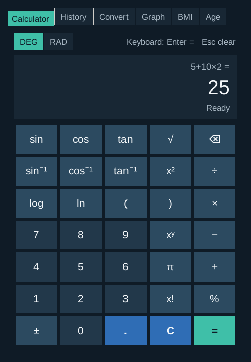
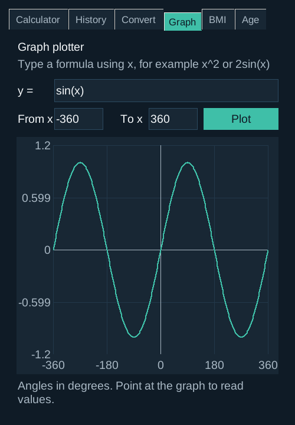

# SmartCalc

A calculator desktop app built with Python and Tkinter for Project 2,
"Building Basic Calculator", at NextHikes IT Solutions. By Amita Yadav.

 

## What it does

- **Calculator tab:** a display screen, clickable buttons, addition,
  subtraction, multiplication and division, `=` to calculate and `C` to clear.
  It also has brackets, percent, powers, square root, factorial, log, ln, and
  sin, cos and tan with separate **DEG** and **RAD** buttons.
- **History tab:** every answer, newest first. Double-click one to use it again.
  The history is saved to `.smartcalc_history.json` in your home folder, so it
  is still there the next time you open the app (latest 100 answers).
- **Convert tab:** converts currency, length, weight, volume, speed, time and
  temperature. The answer updates as you type, and ⇄ swaps the two units.
  Currency uses today's exchange rates from the European Central Bank (through
  the free Frankfurter service). The last rates are saved in
  `.smartcalc_rates.json` in your home folder, so currency still works offline.
- **Graph tab:** type a formula using `x`, such as `sin(x)`, `x^2 - 4` or
  `2sqrt(x)`, choose the range of x and press Plot. Point at the graph to read
  the value at any x. Angles follow the DEG/RAD buttons.
- **BMI tab:** body mass index and its WHO category from weight and height.
- **Age tab:** exact age in years, months and days, and days to the next birthday.

Function buttons work on the number on screen: type `81` and press `√` to get `9`.
You can also type with the keyboard: Enter or `=` calculates, Esc clears.
Multiplication can be written as on paper: `2(3+4)` or `2π`.
Wrong input such as `a + b` shows "Error: Invalid input" instead of crashing.

## Files

| File | What it is |
|---|---|
| `main.py` | The window: tabs, buttons, display and keyboard handling |
| `calculator_engine.py` | The maths: reads a sum safely and calculates it, plus graph points, unit and currency conversion, BMI, age and saving the history |
| `test_calculator_engine.py` | Automatic tests for the maths |

The app never uses Python's `eval()`, so text typed into the calculator can
never run as program code.

## Run it

Needs Python 3.9 or newer. Tkinter comes with Python, so nothing else to install.

```bash
python3 main.py
```

In VS Code: open this folder, open `main.py`, and press the Run (▶) button.
On Windows use `python main.py`.

## Run the tests

```bash
python3 -m unittest -v
```

## Tools

Python, Tkinter and ttk (including Canvas for graphs), math, ast, re, datetime, json, pathlib,
urllib, threading, unittest, Visual Studio Code, GitHub.

## References

- GeeksforGeeks: Python GUI calculator using Tkinter
- Python documentation: tkinter, tkinter.ttk, math, ast
- World Health Organization: adult BMI categories
- NIST: unit conversion factors
- Frankfurter (frankfurter.dev): free European Central Bank exchange rates
